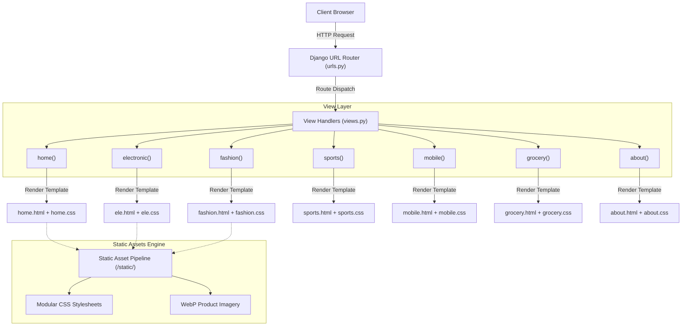

# 🛍️ ECOM — Multi-Category Django E-Commerce Web Platform

[](https://www.djangoproject.com/)
[](https://www.python.org/)
[](https://developer.mozilla.org/)
[](https://developer.mozilla.org/)
[](LICENSE)

**ECOM** is a multi-vertical e-commerce web platform engineered natively with **Django 6** and modular CSS3. Built with a focus on clean MVT (Model-View-Template) architecture, the platform features dedicated product category storefronts, intuitive navigation, and high-performance WebP media rendering.

---

## 🌟 Executive Summary & Key Highlights

- **Pure Django Implementation**: Built entirely on Django’s native full-stack capabilities, showcasing deep fundamentals of Django's routing, template rendering, and static file asset pipelines without external runtime dependencies.
- **Modular Stylesheet Architecture**: Employs domain-specific stylesheets (`fashion.css`, `ele.css`, `sports.css`, `grocery.css`, `mobile.css`, `home.css`) ensuring modular CSS scoping, custom theming per category, and maintainable styles.
- **Next-Gen Media Asset Pipeline**: Powered by optimized WebP image compression, minimizing page weight and delivering near-instant First Contentful Paint (FCP).
- **Multi-Vertical Catalog Taxonomy**: Offers 5 distinct commercial retail verticals alongside a featured homepage collection:
  - ⚡ **Electronics**: Gaming consoles, laptops, professional DSLR cameras, and tablets.
  - 👗 **Fashion**: Apparel, designer collections, and accessories.
  - 📱 **Mobile & Devices**: Smartphones and smart devices.
  - 🍏 **Grocery & Essentials**: Daily essentials and consumer packaged goods.
  - ⚽ **Sports & Fitness**: Athletic equipment and sporting goods.
- **Responsive Flexbox Grid**: Clean responsive card grids with hover transitions, sticky navigation headers, and mobile-friendly viewport scaling.

---

## 🏗️ Architecture & Workflow



---

## 📁 Project Structure

```text
Ecom/
├── .gitignore                    # Excludes venv, db.sqlite3, __pycache__
├── requirements.txt              # Production dependency specifications
├── README.md                     # Comprehensive project documentation
│
└── myproject/                    # Main Django application root
    ├── manage.py                 # Django command-line utility
    │
    ├── myproject/                # Core configuration package
    │   ├── __init__.py
    │   ├── asgi.py               # ASGI server configuration
    │   ├── settings.py           # Application settings & asset declarations
    │   ├── urls.py               # Central URL dispatching registry
    │   ├── views.py              # Controller view functions
    │   └── wsgi.py               # WSGI production deployment entrypoint
    │
    ├── templates/                # Presentation layer templates
    │   ├── about.html            # Brand & company overview
    │   ├── ele.html              # Consumer electronics catalog
    │   ├── fashion.html          # Fashion & apparel catalog
    │   ├── grocery.html          # Groceries & supermarket catalog
    │   ├── home.html             # Featured storefront & landing page
    │   ├── mobile.html           # Smartphone & mobile catalog
    │   └── sports.html           # Sports & outdoor gear catalog
    │
    └── static/                   # Static assets pipeline
        ├── css/                  # Scoped stylesheets
        │   ├── about.css         # About page typography & styling
        │   ├── ele.css           # Electronics grid & badge styles
        │   ├── fashion.css       # Fashion aesthetic & card styling
        │   ├── grocery.css       # Supermarket layout styles
        │   ├── home.css          # Landing page navigation & layout
        │   ├── mobile.css        # Mobile device card styles
        │   └── sports.css        # Athletic equipment showcase styles
        │
        └── images/               # Optimized product media (WebP/JPG)
            ├── 1.webp - 5.jpg    # Homepage banner & featured imagery
            ├── ele1 - ele4.webp  # Electronics catalog media
            ├── fas1 - fas4.webp  # Fashion catalog media
            ├── gro1 - gro4.webp  # Grocery catalog media
            ├── mob1 - mob4.webp  # Mobile catalog media
            └── spo1 - spo4.webp  # Sports catalog media
```

---

## ⚙️ Installation & Local Setup

### 1. Clone the Repository
```bash
git clone https://github.com/Sushanth-yadav/<repo-name>.git
cd <repo-name>
```

### 2. Set Up Virtual Environment
- **Windows (Command Prompt / PowerShell):**
  ```powershell
  python -m venv venv
  .\venv\Scripts\activate
  ```
- **macOS / Linux:**
  ```bash
  python3 -m venv venv
  source venv/bin/activate
  ```

### 3. Install Required Dependencies
```bash
pip install -r requirements.txt
```

### 4. Run Initial Migrations
Navigate into the directory containing `manage.py` and run:
```bash
cd myproject
python manage.py migrate
```

### 5. Launch the Development Server
```bash
python manage.py runserver
```

Open your browser and navigate to:  
👉 **[http://127.0.0.1:8000/](http://127.0.0.1:8000/)**

---

## 🧭 URL Routing & Navigation Reference

| Endpoint Route | View Identifier | Category / Purpose |
| :--- | :--- | :--- |
| `/` | `home` | **Storefront**: Landing page with featured collection |
| `/electronic/` | `ele` | **Electronics**: High-end gadgets, consoles, laptops |
| `/fashion/` | `fashion` | **Fashion**: Designer apparel, wear, and collections |
| `/mobile/` | `mobile` | **Mobile Devices**: Smartphones & handheld tech |
| `/sports/` | `sports` | **Sports & Fitness**: Athletic equipment and gear |
| `/grocery/` | `grocery` | **Grocery**: Daily essentials and food products |
| `/about/` | `about` | **About**: Corporate background & portal info |

---

## 💼 Resume Highlights & Talking Points

When presenting this project in technical interviews:
1. **Architectural Purity**: Highlights understanding of how Django handles the complete request-response cycle from `urls.py` through `views.py` to compiled template rendering without relying on third-party frameworks.
2. **Static Asset Pipeline Mastery**: Demonstrates knowledge of Django's `STATIC_URL` and `STATICFILES_DIRS` configurations, asset caching, and file organization for high-performance production readiness.
3. **Frontend Modularity**: Discuss the design decision to create individual scoped stylesheets per category, allowing isolated style evolution without global cascade conflicts.

---

## 🔮 Scalability & Future Roadmap

- [ ] **Dynamic Database Integration**: Transition static catalog arrays into Django ORM models (`Category`, `Product`, `ProductImage`).
- [ ] **Shopping Cart & Session State**: Implement session-backed persistent shopping cart.
- [ ] **Payment Gateway Integration**: Connect Stripe or Razorpay for live checkout processing.
- [ ] **Search & Filtering Engine**: Integrate full-text search with Django `Q` objects and category filtering.
- [ ] **Containerization & CI/CD**: Dockerize application with Gunicorn and Nginx reverse proxy.

---

## 📄 License
This project is open-source and available under the [MIT License](LICENSE).
